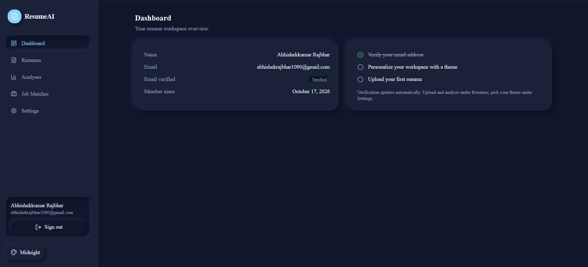
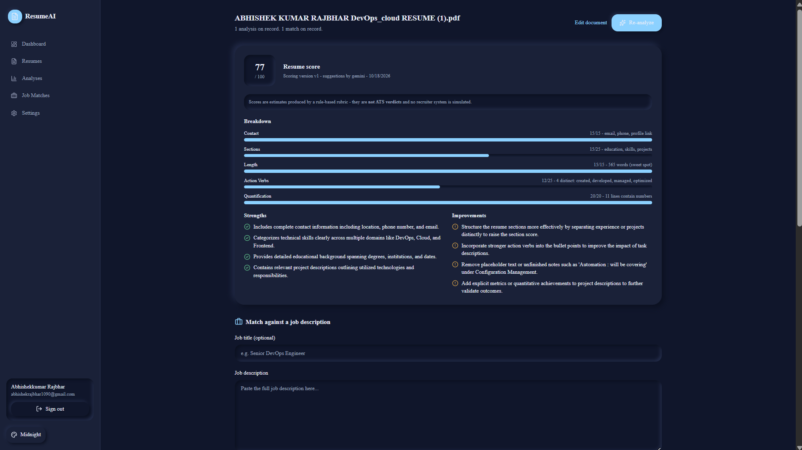
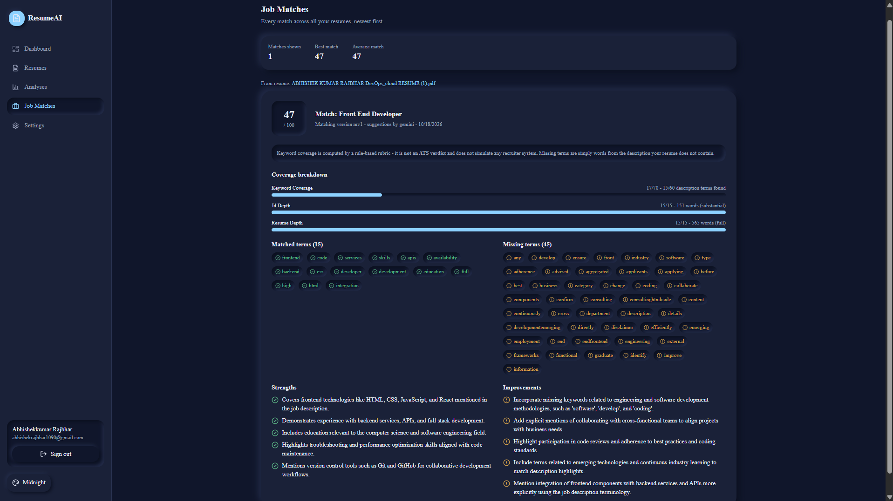

# ResumeAI

> Upload a resume. Understand it. Match it. Export it.

ResumeAI is a full-stack, AI-powered resume platform: a **Next.js 14** frontend, a
**FastAPI** backend, and **PostgreSQL** working together to take a resume from raw
PDF/DOCX to a polished, exported document. Upload, review what the AI extracted, get an
explainable score, match against a job description, edit with professional templates,
and export a clean PDF.

Every AI output is provenance-backed. Deterministic scores are computed separately from
LLM text, and every report stores the `scoring_version` that produced it. Scores are
estimates, never ATS verdicts — the UI says so, everywhere.

**[Open the live app](https://resume-ai-psi-three.vercel.app)** ·
**[API docs](https://resumeai-09qw.onrender.com/docs)** ·
**[Project site](https://abhisherk01.github.io/ResumeAI/)** ·
**[Development log](#development-log)**

## Screenshots

| Dashboard | Analysis | Job match |
| :---: | :---: | :---: |
|  |  |  |

*Captured from the live deployment in the midnight theme.*

## Why ResumeAI is different

- **Provenance-backed AI.** Deterministic scoring and LLM narrative are separate code
  paths. Every report stores the scoring version that produced it, so the numbers on
  screen can be explained and reproduced — not just trusted.
- **Honest by design.** Scores are estimates, never ATS verdicts. The disclaimers live
  inside the product, not only in the marketing.
- **Swappable AI.** A provider abstraction sits behind every AI call: Gemini free tier
  by default, a deterministic mock in every test, room for more providers later.
- **Security-first accounts.** Hashed session tokens, CSRF double-submit, Argon2id
  passwords, anti-enumeration responses, sliding-window rate limits.
- **Actually tested.** 159 frontend component tests, a full pytest suite, ruff, eslint,
  and strict TypeScript — gated by GitHub Actions on every push.

## Features

### Resume pipeline

- Upload PDF/DOCX with validation and text extraction.
- Review AI-extracted data before anything is saved — you approve what the model saw.
- Every document is scoped to the authenticated user.

### Explainable scoring

- Deterministic scoring engine, versioned per report (`scoring_version`).
- LLM-generated improvement suggestions rendered separately from the numbers.
- Reports show their provenance instead of asking for blind trust.

### Job description matching

- Paste any job description and compare it against the resume.
- Skill-gap analysis and keyword-coverage reporting.
- Match reports are stored alongside analyses in history.

### Editor & export

- Four professional templates with accent-color options.
- Live editing of the extracted resume data.
- One-click polished PDF export.

### History & reports

- Every analysis and match report is saved to the account.
- Re-open any past report at any time.

### Accounts & security

- Email verification and password reset with single-use, hashed tokens.
- Profile display-name updates and authenticated password changes.
- Individual or global session revocation; sessions expire after 7 days.

## Architecture

```text
              ┌───────────────────────────────┐
              │         Browser (you)         │
              └───────────────┬───────────────┘
                              │
              ┌───────────────▼───────────────┐
              │      Next.js 14 · Vercel      │
              │  App Router · TS · Tailwind   │
              └───────────────┬───────────────┘
                              │  HTTPS · session cookie + CSRF header
              ┌───────────────▼───────────────┐
              │    FastAPI · Render (Docker)  │
              │   Pydantic v2 · SQLAlchemy    │
              │  ┌─────────────────────────┐  │
              │  │ AI provider abstraction │  │
              │  │  Gemini / mock (tests)  │  │
              │  └─────────────────────────┘  │
              └──────┬──────────────────┬─────┘
                     │                  │
        ┌────────────▼─────────┐  ┌─────▼────────────────┐
        │  Neon · PostgreSQL   │  │   Resend · email     │
        │ Alembic migrations   │  │   verify · reset     │
        └──────────────────────┘  └──────────────────────┘
```

The browser only ever talks to the Next.js app. In production, `/api/v1/*` is rewritten
by `vercel.json` to the FastAPI service on Render — same-origin requests, first-party
session cookies, and no CORS on the critical path.

## Tech Stack

| Layer    | Technology                                                     |
| -------- | -------------------------------------------------------------- |
| Frontend | Next.js 14 (App Router), TypeScript strict, Tailwind, Radix UI |
| Backend  | Python 3.12, FastAPI, Pydantic v2, SQLAlchemy 2.x              |
| Database | PostgreSQL 16 (Neon in production, migrations via Alembic)     |
| AI       | Provider abstraction: Gemini free tier default, mock in tests  |
| Email    | Resend in production, log transport in development             |
| Infra    | Docker Compose (local), GitHub Actions CI                      |
| Deploy   | Vercel (frontend) + Render (backend) + Neon (DB) — live        |

## Project Structure

```text
resumeai/
|-- backend/            # FastAPI app (app/, tests/, alembic/, Dockerfile)
|-- frontend/           # Next.js app (src/, Dockerfile, vercel.json)
|-- docs/               # GitHub Pages landing page + screenshots
`-- docker-compose.yml  # Local orchestration: db + backend + frontend
```

## Quickstart (Docker)

Prerequisite: Docker Desktop. Node.js is only needed for frontend tooling outside Docker.

```bash
git clone https://github.com/Abhisherk01/ResumeAI.git
cd ResumeAI
cp backend/.env.example backend/.env
docker compose up --build
```

| Service   | URL                          |
| --------- | ---------------------------- |
| Frontend  | [http://localhost:3000](http://localhost:3000) |
| API docs  | [http://localhost:8000/docs](http://localhost:8000/docs) |
| Health    | [http://localhost:8000/health](http://localhost:8000/health) |
| Readiness | [http://localhost:8000/ready](http://localhost:8000/ready) |

Register with any real inbox, then grab the verification link from the backend log —
development uses a log email transport, no SMTP required:

```bash
docker compose logs backend --tail 50
```

For live LLM analysis, add your Gemini API key (the free tier is sufficient) to
`backend/.env` — the example file documents every variable the backend expects, including
database URL and email transport settings. Tests always use the mock provider, and local
Docker runs need no extra frontend configuration.

### Useful commands

```bash
docker compose exec backend pytest -v           # backend tests
docker compose exec backend ruff check .        # backend lint
docker compose exec backend ruff format .       # backend format
docker compose exec frontend npm test           # frontend component tests
docker compose exec frontend npx tsc --noEmit   # frontend type check
docker compose exec frontend npm run lint       # frontend lint
docker compose exec frontend npm run format     # frontend format
```

> **Never run `npm run build` while the frontend dev container is running** — both write
> to the same `.next` directory. Use this sequence:

```bash
docker compose stop frontend
docker compose run --rm frontend npm run build
Remove-Item -Recurse -Force frontend\.next   # PowerShell; rm -rf frontend/.next elsewhere
docker compose start frontend
```

## Testing & CI

- **Backend:** pytest suite, ruff lint + format.
- **Frontend:** 159 Vitest component tests, `tsc --noEmit` strict type check, eslint.
- **CI:** GitHub Actions runs lint, type check, and both test suites on every push.

<details>
<summary><b>Manual E2E checklist (auth &amp; account)</b></summary>

Run against [http://localhost:3000](http://localhost:3000) after any auth-adjacent change:

- Logged out: `/dashboard` redirects to `/login`; landing page renders normally.
- Register: "Check your inbox" state; exactly one email in the backend log.
- Newest verification link: "Email verified." Superseded links: "invalid or has
  expired" with no retry button.
- Login: lands on `/dashboard`; sidebar shows name and email; theme switcher works.
- Wrong password: "Email or password is incorrect." (identical for unknown emails).
- Unverified login: "Please verify your email address before signing in."
- Reset loop: forgot-password → link from logs → new password → "Password updated";
  old session dead; new password logs in.
- Rate limiting: 6 rapid failed logins; the 6th shows "Try again in about 15 minutes."
- Profile: change display name in `/settings`; sidebar updates instantly (no refresh)
  and persists across a reload.
- Password change: with two sessions open, change the password in one; the other session
  is kicked to `/login` on its next request, the changing session stays alive, and a
  wrong current password shows inline on the field.

</details>

## Security model

- **Server-side sessions.** The cookie holds a random 256-bit token; only its SHA-256
  hash is stored — no JWTs. Sessions expire after 7 days and can be revoked individually
  or all at once.
- **CSRF double-submit.** The JS-readable `csrf_token` cookie must be echoed in the
  `X-CSRF-Token` header on every mutating request; its hash is bound to the session row.
- **Passwords.** Argon2id (OWASP-aligned defaults), 8–128 characters, no composition
  rules (NIST 800-63B). Weak/legacy hashes are transparently upgraded on login.
- **Email tokens.** Verification (24 h) and reset (30 min) tokens are single-use, hashed
  at rest, atomically consumed, and superseded when reissued. A password reset revokes
  every session.
- **Account changes.** Password change requires the current password and revokes every
  other session while keeping the one performing the change. Email address changes are
  designed to verify the NEW address first — deliberately deferred.
- **Anti-enumeration.** Registration and reset responses are identical whether or not an
  email has an account; all login failures share one generic error; the unknown-email
  path burns equivalent CPU time.
- **Rate limiting** (sliding window, per IP):

  | Endpoint group                         | Limit | Window  |
  | -------------------------------------- | ----- | ------- |
  | Login                                  | 5     | 15 min  |
  | Register                               | 5     | 60 min  |
  | Password reset                         | 3     | 60 min  |
  | Token endpoints (verify/reset confirm) | 10    | 15 min  |

  `Retry-After` is exposed via CORS so the UI can show a precise countdown.

- **Security headers.** `nosniff`, frame-deny, strict referrer policy, API-profile CSP,
  `no-store`, permissions policy; HSTS in production only.

## Deployment

| Piece    | Platform | Notes                                                                  |
| -------- | -------- | ---------------------------------------------------------------------- |
| Frontend | Vercel   | `/api/v1/*` rewritten to the backend — same-origin session cookies     |
| Backend  | Render   | Docker container; free tier may cold-start (~30–60 s on the first hit) |
| Database | Neon     | Managed PostgreSQL 16                                                  |
| Email    | Resend   | Transactional email behind the same `EmailSender` interface            |

Local Postgres credentials in `docker-compose.yml` are for development only. Production
secrets are platform-managed; `.env` files are git-ignored and must never be committed.

## Development Log

Thirteen phases, 0 through 12, each closed out with green gates before the next began.

<details>
<summary><b>Phase 0 — Requirements &amp; architecture</b></summary>

- Defined the product scope end to end: upload → review → score → match → edit → export.
- Chose the split: FastAPI backend, Next.js frontend, PostgreSQL, provider abstraction for AI.
- Set the honest-AI principles up front: deterministic scoring separate from LLM text, no ATS verdict claims.

</details>

<details>
<summary><b>Phase 1 — Project initialization</b></summary>

- Monorepo layout: `backend/`, `frontend/`, docker orchestration from day one.
- Tooling baseline: TypeScript strict, ruff, pytest, Vitest; env templates and git-ignore hygiene.

</details>

<details>
<summary><b>Phase 2 — Design system &amp; landing page</b></summary>

- Tailwind + Radix UI foundation with accessible primitives.
- Light/dark/system theme switcher; landing page with honest copy.

</details>

<details>
<summary><b>Phase 3 — Authentication &amp; user management</b></summary>

- Server-side sessions: random 256-bit token, SHA-256 hash at rest, 7-day expiry, revocable.
- CSRF double-submit, Argon2id passwords with transparent legacy-hash upgrade.
- Single-use hashed email tokens (24 h verify / 30 min reset), anti-enumeration responses.
- Sliding-window rate limits per IP with `Retry-After` surfaced to the UI.

</details>

<details>
<summary><b>Phase 4 — Dashboard &amp; settings</b></summary>

- Authenticated dashboard with sidebar identity (name + email) and theme persistence.
- Display-name updates and authenticated password changes; wrong current password shows inline.
- Password change revokes every OTHER session while keeping the one performing it.

</details>

<details>
<summary><b>Phase 5 — Resume upload &amp; document processing</b></summary>

- PDF/DOCX upload with validation and text extraction.
- Review-before-save: extracted data is shown to the user for approval before persistence.
- Per-user scoping established for every stored document.

</details>

<details>
<summary><b>Phase 6 — Explainable scoring &amp; LLM suggestions</b></summary>

- Deterministic scoring engine, fully separated from LLM text; every report stores its `scoring_version`.
- Improvement suggestions generated behind the provider abstraction (Gemini default, mock in tests).

</details>

<details>
<summary><b>Phase 7 — Job description matching</b></summary>

- Resume vs. job-description comparison with skill-gap analysis.
- Keyword-coverage reporting; match reports stored in the user's history.

</details>

<details>
<summary><b>Phase 8 — Editor, templates &amp; PDF export</b></summary>

- Resume editor over the extracted data with live preview.
- Four professional templates and accent-color options.
- Polished PDF export.

</details>

<details>
<summary><b>Phase 9 — History &amp; reports</b></summary>

- Analysis and match history scoped to the authenticated user.
- Any past report re-openable at any time.

</details>

<details>
<summary><b>Phase 10 — Integration, security &amp; performance</b></summary>

- End-to-end flows wired: upload → analysis → match → edit → export.
- Security headers finalized: `nosniff`, frame-deny, referrer policy, API-profile CSP, `no-store`, permissions policy; HSTS production-only.
- Performance passes across the request path.

</details>

<details>
<summary><b>Phase 11 — Docker &amp; CI</b></summary>

- `docker-compose.yml` orchestrating db + backend + frontend for one-command local runs.
- GitHub Actions gating lint, type check, and both test suites on every push.

</details>

<details>
<summary><b>Phase 12 — Deployment</b></summary>

- Live: Vercel (frontend) + Render (backend container) + Neon (managed PostgreSQL).
- Resend transactional email behind the same `EmailSender` interface; secrets platform-managed.
- Same-origin `/api/v1` proxy for first-party session cookies — CORS off the critical path.
- Post-deploy polish: stale onboarding copy replaced with live links; test-setup shim for
  broken native localStorage on Node 25+ runtimes.

</details>

## Roadmap

- Email-address change flow: verify the NEW address first (designed, deliberately deferred).
- More AI providers behind the same abstraction.
- Richer match analytics across successive versions of the same resume.
- Optional: restrict OpenAPI/docs routes in production.

## License

MIT — see [LICENSE](LICENSE).

## Author

Built by [@Abhisherk01](https://github.com/Abhisherk01) as a production-grade portfolio
project: phased development, tested, documented, and deployed without hand-waving.
